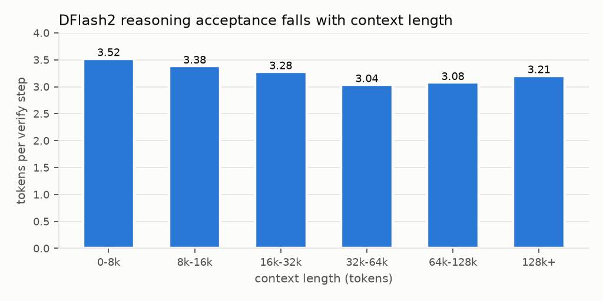
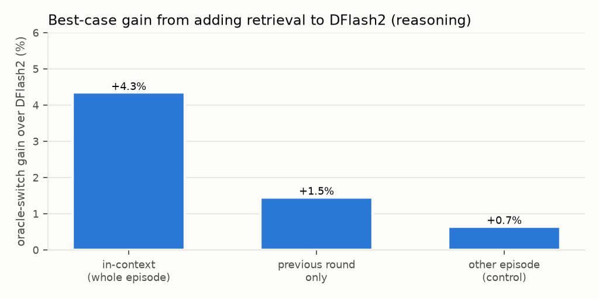

# Phase 3: structure profiling of PEAR + DFlash2 on LIBERO (2026-11-15)

**Question.** Does the structure of robot reasoning (the reasoning vs. action phases, sub-phases within reasoning, and
repetition across control rounds) leave speculative-decoding headroom that DFlash2 does not already capture?

**Short answer: no, not enough to justify a new algorithm.**
- The action phase is 2.9% of generated tokens.
- Cross-round reuse adds at most +1.5%, an oracle upper bound and statistically no better than generic retrieval.
- Even an oracle that switches to in-context retrieval at every step DFlash2 loses adds at most +4.4% on reasoning.
- The one sizeable effect is a 14% acceptance decline as context grows. That effect is already published (DLite), and
  fixing it means retraining the drafter.

## Setup (what was actually run)
| Item | Value |
|---|---|
| Target | `mit-han-lab/Qwen3.8-27B-PEAR`, BF16 (the paper's evaluation precision) |
| Drafter | `incoai/Qwen3.8-27B-DFlash2`: block 8 (7 drafts), top-k 16 candidates + selector, probabilistic sampling path; 2,048-token sliding window per drafter layer (honored by SGLang) |
| Engine | SGLang git `7476772` (DFLASH worker v2), torch 2.14.1+cu130 via the CUDA 13.0 forward-compat driver, 1× H200 SXM, `--max-running-requests 1` (PEAR deploys one session per GPU), prefix caching on |
| Sampling | temperature 1.0, top-p 0.95 (PEAR deploy config), `reasoning_effort` xhigh, `preserve_thinking` true |
| Conversation | PEAR's exact system prompt, environment prompt, user-turn text and reminder, and 2 × 512-px frames per turn. Turns are appended as text, as verl's token-level concatenation does. Action = the last ```` ```json ```` block after `</think>`, checked against `LiberoEnv.SCHEMA` |
| Simulator | PEAR's own `LiberoEnv` (LIBERO `8f1084e`, seed 7, 10 stabilization steps, suite step caps), in-process. **Deviation:** frames are rendered with NVIDIA EGL, not Mesa llvmpipe (Mesa's EGL device platform was unavailable in the container); pixels may differ slightly from PEAR's |
| Episodes | 14: libero_spatial and libero_object tasks {0,2,4,6,8}; libero_goal {0,2}; libero_10 {0,2}; trial 0, seed 0. Two goal and libero_10 tasks were dropped for time (a goal episode ran 26 rounds and 184k tokens) |
| Instrumentation | (1) Per-request server counters (`spec_verify_ct`, accepted-drafts histogram). (2) A 4-line patch to SGLang `Req.update_spec_correct_drafts_histogram` logging `(rid, output position, accepted drafts)` for **every verify step**. (3) The recorded output token ids |
| Phase split | Each round = request A (stop on the `</think>` token id) + request B (the rest). Splitting leaves the sampled distribution unchanged: generation resumes from the same prefix and the prefix cache serves B's prefill |

**Episodes:** 12 of 14 succeeded. Mean 12.2 rounds and 29.3k generated tokens per episode (median 12.0k); max context
155k tokens. Reasoning averages 2,340 tokens per round (median 964); the answer averages 61 (median 58). The paper reports
19.7 rounds and 94k tokens per episode on its full evaluation. Our sample is smaller and shorter.
- **Excluded:** 1 degenerate round (libero_goal t0, round 25), 45k tokens of `~?~?~?…` at about 180k context, 7.8 tokens
  per verify step. A repetition loop would inflate acceptance. Its cause (model behavior vs. numerical behavior of this
  stack at very long context) is undetermined.

Raw data: `results/dflash2_main/` (per-round JSONL, per-step log, frames on the pod). Summaries:
`steps_summary.json` and `traces_summary.json`. Scripts: `scripts/run_episodes.py`, `scripts/analyze_steps.py` and
`scripts/analyze_traces.py`.

## Experiment A: acceptance by phase

| Phase | Tokens | Share | Verify steps | Tokens / step (95% CI) | Steps accepting all 7 | Steps accepting 0 | Amdahl max speedup if free |
|---|---|---|---|---|---|---|---|
| Reasoning (`<think>…</think>`) | 354,959 | 97.1% | 109,180 | **3.25** (3.24–3.27) | 6.7% | 23.4% | 35× |
| Answer (text + action JSON) | 10,447 | **2.9%** | 1,696 | **6.16** (6.05–6.27) | 55.0% | 3.2% | **1.029×** |

- DFlash2's reasoning acceptance (3.25 tokens per step) matches the PEAR paper's average acceptance of 3.2. The
  instrumentation reproduces the published number.
- The action is already easy for DFlash2: 55% of its verify steps accept the full block. Even making the whole answer
  free (zero cost) would speed decoding up by at most **2.9%**. **A1 (a separate drafter or schedule for the action) is
  dead by Amdahl.**

### A2: structure within the reasoning
| Slice (reasoning steps) | Steps | Tokens / step |
|---|---|---|
| First 10% of the reasoning | — | 3.41 |
| Deciles 2–10 | — | 3.20–3.30 (flat) |
| Preceding 6 tokens contain ≥2 digits ("numeric": coordinates, arithmetic) | 18,873 | **3.68** (3.65–3.71) |
| Otherwise ("prose") | 90,307 | **3.16** (3.15–3.18) |

- The label is computed from the context *before* each step, so it does not depend on the outcome.
- Sub-phase structure exists: numeric reasoning is 16% easier. But it is a *per-step difficulty* signal of the kind that
  generic adaptive methods (SpecDec++, AdaEDL, BanditSpec, and WhiFlash's entropy router) are built to exploit.
- DFlash2 also drafts a whole block in one parallel pass. A per-step choice can only change how many drafted tokens are
  verified, and at batch size 1 the verify cost barely depends on that number (see `BASELINE_REPORT.md`, K = 3 vs. 7).

### Acceptance vs. context length (reasoning steps)
| Context (tokens) | 0–8k | 8–16k | 16–32k | 32–64k | 64–128k | >128k |
|---|---|---|---|---|---|---|
| Steps | 21,259 | 17,946 | 19,155 | 18,729 | 24,619 | 7,472 |
| Tokens / step | **3.52** | 3.38 | 3.28 | **3.04** | 3.08 | 3.21 |



- Acceptance falls by 14% from short to 32–64k context.
- Round index is confounded with context length. Round-0 reasoning (no history) gives 3.47; rounds ≥15 give 3.11.
- The >128k bin comes from a single episode.
- The drafter attends to a 2,048-token window, so this decline is DLite's "long multi-turn context degrades the drafter"
  effect. That is published, and DLite's remedy is a different drafter. **Not a new direction for us.**

## Experiment B: cross-round reuse
**Method.**
- **Unbiasedness:** for a deterministic drafter under lossless verification, P(first m drafts accepted) = Π p(dⱼ |
  prefix). That equals the probability that the realized sample matches the drafts for m positions. So replaying the
  drafter along the recorded token sequence gives an unbiased estimate of its online acceptance, and needs no logits.
  `tests/test_specdec_core.py` checks the formula against Monte-Carlo rejection sampling.
- **Drafter:** suffix-match n-gram (n = 8…2, most recent occurrence, K = 7).
- **Corpora compared:**
  - `ctx`: everything the episode generated so far, including earlier rounds' thinking (in context because
    `preserve_thinking=true`).
  - `prev`: only the immediately preceding round.
  - `shuffled`: a same-index round from a *different* episode. This is the control for generic phrasing.
  - `self`: only the current round.

**B1, retrieval alone** (rounds ≥1; 156 rounds, 306,776 tokens):
| Drafter | Tokens / step | Steps accepting ≥4 |
|---|---|---|
| `ctx` (prompt lookup over the whole episode) | 1.55 | 3.9% |
| `self` (current round only) | 1.29 | 1.8% |
| `prev` (previous round only) | 1.24 | 1.4% |
| `shuffled` (other episode, control) | 1.09 | 0.5% |
| DFlash2 (measured, all reasoning steps incl. round 0) | 3.25 | 24.5% |

**B2, complementarity with DFlash2** (110,876 measured DFlash2 steps). At each step DFlash2 actually took, we compute
the retrieval drafter's match length m and DFlash2's accepted count a. "Oracle switch" = mean(max(a, m)) + 1. This is
an **upper bound** for any DFlash2 + retrieval hybrid at the same verify cost, because a real router has to predict which
drafter to trust.

| Phase | Corpus | P(retrieval beats DFlash2) | Oracle-switch gain (95% CI) |
|---|---|---|---|
| Reasoning | `ctx` | 6.2% | **+4.35%** (3.95–4.73) |
| Reasoning | `prev` | 2.3% | +1.46% (1.05–1.84) |
| Reasoning | `shuffled` | 1.0% | +0.65% (0.26–1.04) |
| Answer | `ctx` | 26.7% | +17.1% (15.7–18.3) |
| Answer | `prev` | 25.9% | +16.7% (15.4–17.9) |
| Answer | `shuffled` | 24.8% | +16.9% (15.6–18.1) |



**Reading.**
- **Reasoning:** the whole cross-round signal (prev vs. shuffled) is worth **< 1 percentage point**, even as an oracle.
  Everything retrieval can add, from the full in-context corpus, is ≤ 4.4%. That is published Graft / SuffixDecoding
  territory and could not survive a real router's mispredictions.
- **Answer:** retrieval helps more, but an *unrelated* episode's answer helps as much as this episode's previous answer.
  That is schema regularity (the JSON keys), not temporal structure, and it is only 2.9% of the tokens. Upper bound on
  end-to-end decode savings: 0.029 × 17% ≈ 0.5%.
- **Verdict:** no non-verbatim, observation-conditioned reuse structure appears that a new drafter could exploit. The
  verbatim component is small and already published.

## Experiment C: quantization and acceptance
**Not run.** It needs Blackwell (NVFP4) hardware. The literature review already classes it as published (QuantSpec,
QSpec, ML-SpecQD). PEAR's paper also states that NVFP4 *lengthens* chain-of-thought and lowers accuracy, so an
NVFP4 target is not lossless relative to BF16.

## What this rules out for Phase 4
| Candidate | Best-case headroom over DFlash2 (decode) | Status |
|---|---|---|
| A1: phase-specialized action drafting | ≤ 2.9% (Amdahl, oracle) | Dead |
| A2: sub-phase-aware draft length or selection inside reasoning | < 3.5%: a verify step costs 20.8 ms at K = 7 vs. 20.1 ms at K = 3 (`BASELINE_REPORT.md`); pre-empted by SpecDec++, BanditSpec and WhiFlash | Dead (on H200; Blackwell cost curve unmeasured) |
| B: cross-round reuse | ≤ 1.5% temporal (oracle), ≤ 4.4% all retrieval (oracle) | Dead |
| Long-context drafter degradation | ~14% acceptance at 32k+; requires drafter retraining (DLite) | Published, and not a decoding algorithm |
| C: quantization-aware drafting | Not measured | Published, hardware unavailable |
